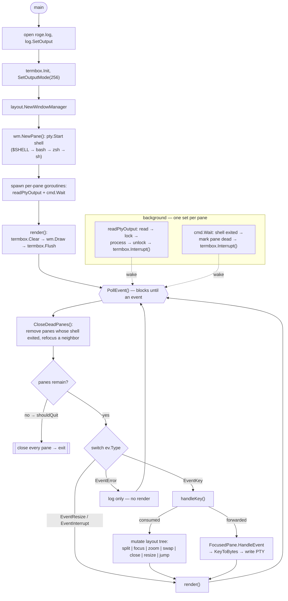

# DOCS.md — Control flow

`roge` is a terminal multiplexer: each pane runs a real shell in a PTY, and a
small VT emulator decodes the shell's output into a cell grid that is drawn
straight into the termbox-Go cell buffer. There is one OS thread for the UI
loop and one goroutine per pane reading PTY output.

## Control-flow overview

### Flowchart (renders on GitHub)



### Plain-text rendering (terminal-safe)

```text
main() [main goroutine]
  |
  +-- 1. open roge.log, log.SetOutput
  +-- 2. termbox.Init, SetOutputMode(256)
  +-- 3. layout.NewWindowManager
  +-- 4. wm.NewPane(): pty.Start(shell: $SHELL -> bash -> zsh -> sh)
  +-- 5. spawn per-pane goroutines: readPtyOutput, cmd.Wait
  +-- 6. render(): termbox.Clear -> wm.Draw -> termbox.Flush
  |
  v
PollEvent()                     [blocks; woken by termbox.Interrupt()]
  |
  v
CloseDeadPanes(): remove every pane whose shell exited, refocus a neighbor
  |
  +-- panes remain? -- no (shouldQuit = true) --> close every pane -> exit
  |
  v
switch (ev.Type)
  |
  +-- EventKey           -> handleKey()
  |      |-- consumed    -> mutate layout tree
  |      |                  (split/focus/zoom/swap/close/resize/jump)
  |      +-- forwarded   -> FocusedPane.HandleEvent
  |                         -> KeyToBytes -> write PTY
  |      render()
  |
  +-- EventResize / EventInterrupt -> render()
  |
  +-- EventError                    -> log only, no render
  |
  v
(loop back to PollEvent)

background goroutines (one set per pane):
  readPtyOutput: read -> lock -> process -> unlock -> termbox.Interrupt()
  cmd.Wait:      shell exited -> mark pane dead -> termbox.Interrupt()
```

## 1. Startup (`main.go`)

1. Open `roge.log`, redirect the process logger to it.
2. `termbox.Init()` — requires a real TTY; fails if stdin is not a TTY.
3. `termbox.SetOutputMode(termbox.Output256)`.
4. `layout.NewWindowManager()`, then `wm.NewPane()` to create pane 1
   (`pane.NewPane("1")`): spawns a shell (`bash`/`$SHELL`/`zsh`/`sh`, first
   found) under `pty.Start(...)`, creates the 80×24 emulator, starts
   `readPtyOutput` and a `cmd.Wait` goroutine.
5. First `render()`: `termbox.Clear` → `wm.Draw(w, h, prefixActive, resizeMode, errorMsg)` → `termbox.Flush()`.

## 2. Main event loop

`for !shouldQuit { termbox.PollEvent() }`, dispatching on `ev.Type`:

- **EventKey:** clears `errorMsg`, calls `handleKey(ev)`. If it returned false
  (unconsumed), the event is handed to `wm.FocusedPane().HandleEvent(ev)`,
  which converts it to bytes and writes them to the PTY. Then `render()`.
- **EventResize / EventInterrupt:** `render()` only.
- **EventError:** logged; no render.

`render()` always runs on the main goroutine — this is the only place the
termbox cell buffer is mutated (see §4).

### Key handling (`handleKey`)

Returns `true` when the multiplexer consumes the event, `false` to forward.

1. **Esc:** cancels prefix/resize mode; forwarded to the shell otherwise.
2. **Ctrl+A:** toggles prefix mode (resize mode cancels first).
3. **Resize mode:** one `h/j/k/l` adjusts the focused pane's size
   (`wm.DecreaseSize`/`IncreaseSize`), drawing ends the mode.
4. **Prefix mode:** `1-9` jumps by pane index; `c`/`-` h-split, `C`/`|`
   v-split, `x` closes (last pane → `shouldQuit = true`), `h/j/k/l` focus,
   `z` zoom toggle, `o` rotate, `{`/`}` swap, `r` enters resize mode,
   `q` quits; arrows move focus. Any other key just ends prefix mode.
   Prefix commands read `ev.Ch`, so they work for letters even though the
   underlying termbox `Key` value is 0.
5. **Default:** return false → key forwarded to the focused shell.

## 3. PTY output → screen

`readPtyOutput` (one goroutine per pane, `pane/readPtyOutput`):

```
read(pty) → lock pane mutex → term.process(bytes) → unlock → termbox.Interrupt()
```

- `termbox.Interrupt()` is safe from any goroutine and wakes a blocked
  `PollEvent`, producing an `EventInterrupt` → `render()`.
- The emulator (`pane/vt.go`) parses ESC/CSI/OSC sequences and maintains an
  authoritative grid plus alternate-screen buffer, scrollback, and cursor.
  Raw shell bytes never reach termbox directly.

## 4. Drawing (`wm.Draw`)

1. Lazily create the first pane if the tree is empty.
2. Carve `height - StatusBarHeight` rows for panes; render status bar last.
3. If zoomed, draw only the zoomed pane; else `distribute` recurses over the
   `LayoutNode` tree assigning rectangles
   (`SplitHorizontal` = stacked rows, `SplitVertical` = side-by-side cols).
4. Each `Pane.Draw(x0,y0,x1,y1,isFocused)`:
   - border (four corners, top/bottom, left/right; blue + bold if focused);
   - if inner `w`/`h` changed: resize emulator and call
     `pty.Setsize(...)` so the shell sees the new size;
   - copy the emulator grid into termbox cells via `cellToTermbox`
     (`vtDefaultColor → ColorDefault`, otherwise the palette index);
   - return the logical cursor (only meaningful when focused).
5. Rendered pane cursor drives `termbox.SetCursor`/`HideCursor`; status bar
   drawn into the last row; `termbox.Flush()`.

## 5. Shutdown

- Each loop iteration calls `wm.CloseDeadPanes()`, which removes any pane whose
  shell exited (e.g. `exit`), re-focusing a neighbor. If the last pane closed
  this way, `shouldQuit` is set and the loop exits.
- Closing the last pane with `x` in prefix mode also sets `shouldQuit`.
- Every pane is closed: `cmd.Process.Signal(os.Interrupt)`, wait up to
  150 ms on `done`, kill if still alive, then close the PTY (a pane whose
  process already exited only has its PTY closed).
- `Cmd.Wait` goroutine marks the pane dead (`setDead` fires an interrupt so the
  main loop can auto-close it) and closes `done`; `readPtyOutput` unblocks on
  the PTY error, waits on `done`, and exits.

## 6. Concurrency model

- **Termbox buffer:** touched only on the main goroutine (`render`/handlers).
  Background code must never call `termbox.SetCell`/`Flush`.
- **Shared state:** each `Pane` has `mu` guarding the emulator (written by
  `readPtyOutput`, read by `Draw`) and `ptyMtx` guarding PTY writes.
- **Synchronization:** background → UI is one-way via `termbox.Interrupt()`.